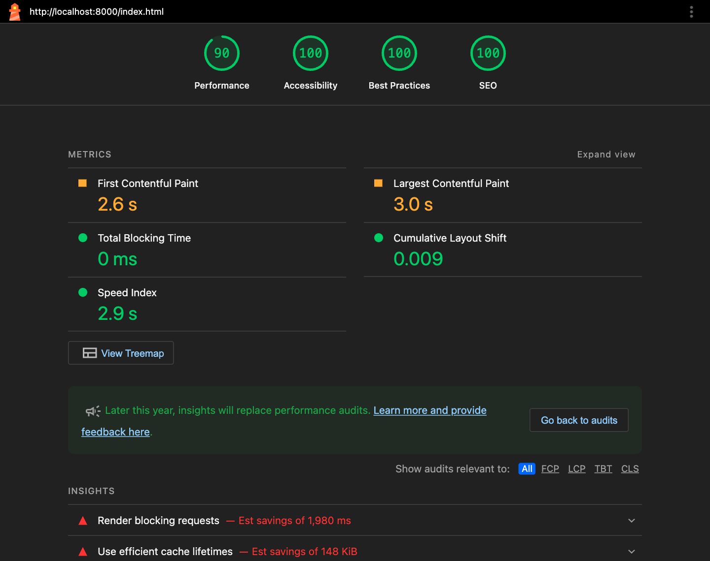
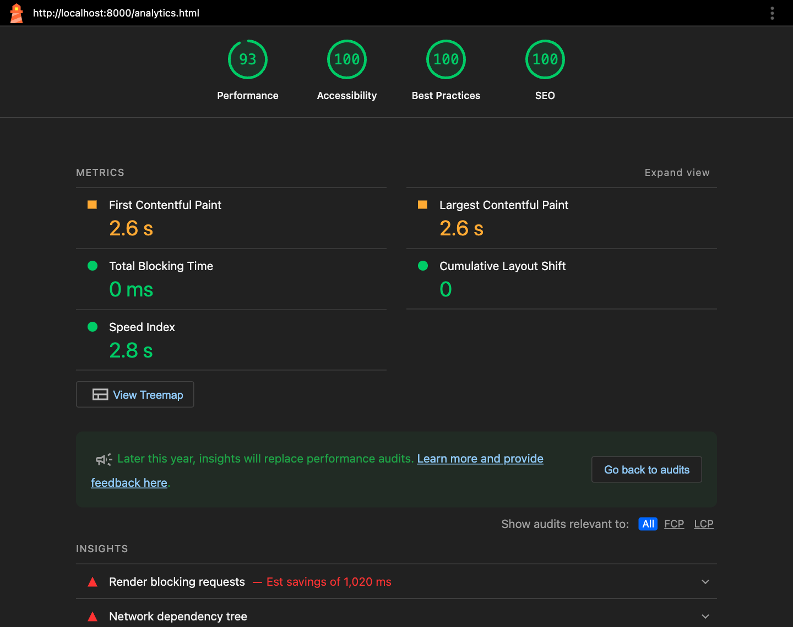
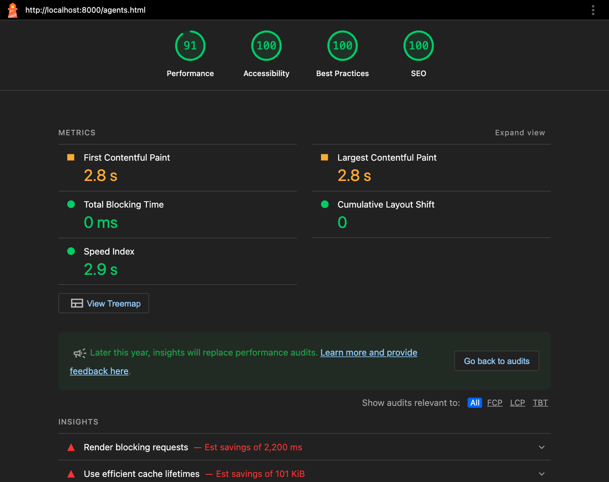
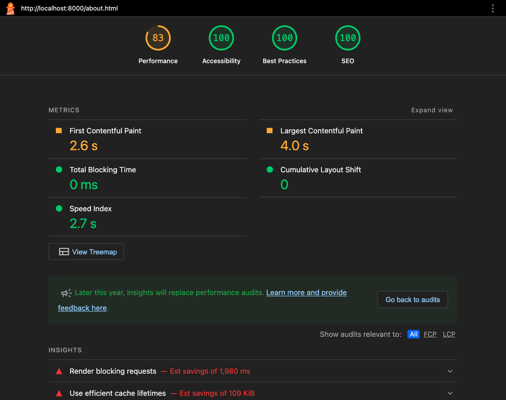
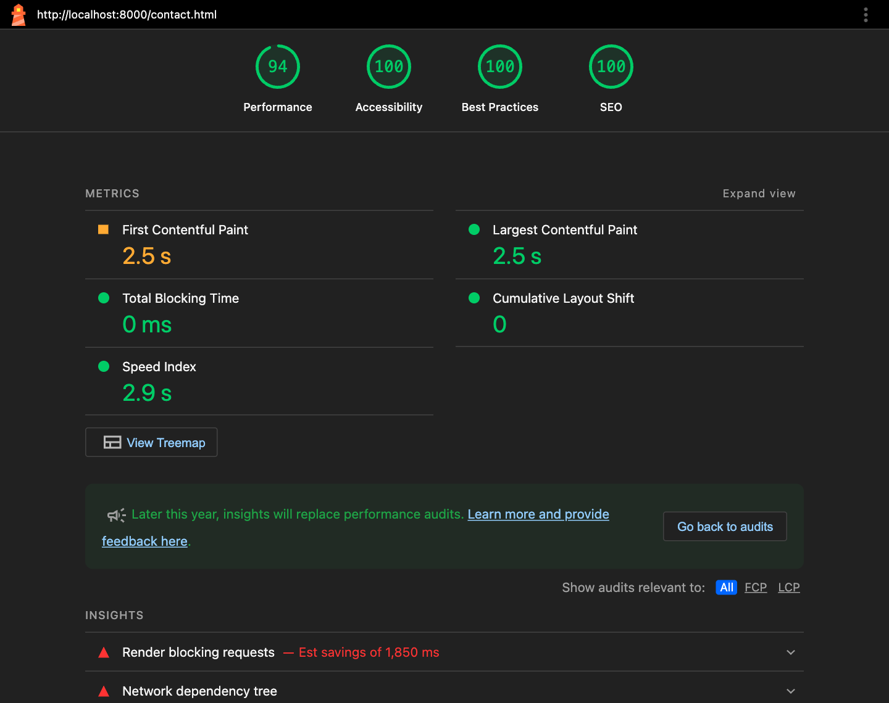

# Taskit

Taskit is a small task manager for teams that hand routine work to AI agents. You add a task, give it to one of four specialist agents, and watch it move from To do to Completed. Tasks can be searched, filtered, sorted, charted and moved on a Kanban board. **The agents are simulated**: a timer in the browser stands in for the agent doing the work. There is no server and no real AI. The site is plain HTML, CSS and JavaScript on top of Bootstrap 5.3.3, and every task stays in the visitor's own browser (`localStorage`).

## Links

- GitHub repository: https://github.com/steveapo/taskit
- Live site: https://taskit-demo.vercel.app

## How to run

- Open `index.html` in a browser,there are no build step and no server requirements: the site works straight from local harddrive. An internet connection is needed for Bootstrap, the fonts, the GitHub feed and the map, but it is otherwise runable either way.
- To run the automated tests, open `tests/tests.html`, the title shows `PASS 23/23` when every test passes.

## The task allocation system

### Data

Every task is a plain object kept by `js/store.js`:

| Field | Meaning |
|---|---|
| `id` | `crypto.randomUUID()`, with a fallback for older browsers |
| `name`, `description` | required, trimmed, at most 80 and 300 characters |
| `dueDate` | `YYYY-MM-DD` string |
| `priority` | `high`, `medium` or `low` |
| `status` | `todo`, `in-progress` or `done` (shown as To do, In progress, Completed) |
| `agentId`, `createdAt` | the assigned agent, and a timestamp |

The four agents are fixed in code (`AGENTS` in `store.js`); users assign tasks to them but can't edit them.

| Agent | Role | Skills |
|---|---|---|
| Athena | Research & planning | Web research, Planning, Summaries |
| Hermes | Writing & communication | Copywriting, Editing, Translation |
| Pythagoras | Data & analysis | Data cleaning, Statistics, Reporting |
| Hephaestus | Code & building | Coding, Debugging, Testing |

### Assigning

The Agent menu in the Tasks form is filled from `store.AGENTS` so a task is assigned when it is created and can be reassigned through Edit. The store never trusts the form: `clean()` checks every field again, and an unknown agent or priority falls back to Athena or Medium. New tasks always start as To do, and can then be changed to reflect the true status (future update could be adding a dropdown for the status on creation).

### The simulation

"Run agent" on a task row and "Run an agent" on the Home page both call `Taskit.sim.run(taskId)` in `js/agent-sim.js`:

1. Only a To do task can be run, so the Run button is disabled for any other status.
2. The task moves to In progress, and the log records "started".
3. After 4 seconds (hardcoded for demo) the simulation reads the task **again** instead of trusting its old copy.
4. If the task was deleted or moved in the meantime, the run is abandoned, so the simulation never overrides the user.
5. Otherwise the task becomes Completed, and the log records "completed".

The timer only lives as long as the page so if the user leaves mid-run, the task stays In progress and can be finished by hand.

### Status changes

Every status change goes through `store.setStatus(id, status, logType)`, which rejects unknown statuses and ignores a move to the current status, so nothing is logged twice. **Complete** (the check button on a row) calls `setStatus(id, 'done', 'completed')`. **The Kanban board** calls `setStatus(id, column)` for drag-and-drop and for its "Move to" menu, logged as "moved"; it is also how a task moves back to To do.

### The activity log

Every change (added, edited, deleted, started, completed, moved) adds one entry, `{ id, type, taskName, agentId, at }`, newest first, capped at **50**. No screen shows more than 8, and without the cap the log would grow forever inside the `localStorage` quota and be re-saved in full on every change.

### Storage

| Key | Where | Holds |
|---|---|---|
| `taskit.tasks` | `localStorage` | the task array (JSON) |
| `taskit.activity` | `localStorage` | the activity log (JSON) |
| `taskit.theme` | `localStorage` | `light` or `dark`, once the toggle is used |
| `taskit.view` | `localStorage` | `list` or `board`, the Tasks page view, once the switch is used |
| `taskit.github.<owner/repo>` | `sessionStorage` | the 5-minute GitHub feed cache |

On a first visit the store seeds six sample tasks across the four agents, priorities and statuses (due dates relative to today) plus three log entries. If storage is blocked or the saved JSON is corrupt, `load()` catches the error, seeds the same data in memory and sets `store.persistent` to `false`; the site keeps working and `layout.js` shows a dismissible warning that changes won't be kept.

## Architecture

### Files

| File | Purpose |
|---|---|
| `index.html` | Home: hero, live app window, feature panels, agents strip |
| `tasks.html` | Tasks: counts, add/edit form, toolbar, List / Board switch (table or Kanban board), Latest activity |
| `analytics.html` | Analytics: counts, two CSS charts, simulated usage |
| `agents.html` | Agents (page of choice): live workload and skills per agent |
| `about.html` | About: purpose, team, testimonial carousel, GitHub activity |
| `contact.html` | Contact: validated form, confirmation modal, map, social links |
| `css/style.css` | design tokens, Bootstrap variable mapping, components, motion |
| `js/layout.js` | in `<head>`: theme, header and footer, icons, form helpers |
| `js/store.js` | the single source of truth: tasks, log, saving, `applyView`, `escapeHtml` |
| `js/ui.js` | shared snippets: status, priority, dates, agent names, count strip |
| `js/agent-sim.js` | the simulated agent run |
| `js/activity.js` | the Latest activity feed and `timeAgo()` |
| `js/kanban.js` | the Kanban board behind the Tasks page's Board view |
| `js/tasks.js`, `home.js`, `analytics.js`, `agents.js`, `about.js`, `contact.js` | one script per page |
| `js/github.js` | About: latest commits from the GitHub REST API |
| `tests/tests.html` | 23 automated tests (not linked from the site) |
| `img/` | logo and team avatars, as SVG |
| `docs/` | the design spec and build plan written before coding |

### One-way data flow

Every action goes to the store, and the store tells the page to redraw:

```
user action (form submit, row button, drag, menu, "Run agent")
        │
        ▼
Taskit.store.addTask / updateTask / deleteTask / setStatus
        │   commit(): add a log entry → save() → dispatch "taskit:change"
        ▼
page listener: document.addEventListener('taskit:change', render)
        │
        ▼
render() rebuilds the table, counts, feed, charts, board or panels from the store
```

Because every mutation ends in the same `commit()`, the log, the saved data and the screen can't drift apart, and the simulation needs no special wiring. `getTasks()` returns copies, so no page can change stored data by accident.

### One global, IIFEs and plain scripts

Each file is an immediately invoked function with `'use strict'` that adds its part to one global, `window.Taskit` (`store`, `ui`, `sim`, `activity`, `icon`, `layout`, `github`); everything else stays private. Plain `<script>` tags load in a fixed order (Bootstrap, `store.js`, then `ui.js` and the other shared modules a page needs, then the page script) instead of ES modules, because browsers block `<script type="module">` on `file://`.

### Shared code

`js/layout.js` injects the header and footer, so the navigation lives in one array and the current link gets `aria-current="page"`. It also applies dark mode, provides `Taskit.icon(name)`, and holds the form helpers both forms use: `validateForm(form)`, `linkErrors(form, { fieldId: errorId })` (sets `aria-invalid` and `aria-describedby` only while a field is invalid) and `clearValidation(form)`.

`js/ui.js` (`Taskit.ui`) holds the snippets several pages draw the same way, so each is written once: `statusIcon()` and `statusHtml()` (circle, pulsing dot or check and the word), `priorityHtml()`, `dueHtml()` and `shortDate()` ("20 Oct", showing a broken saved date as it is), `agentName()`, and `renderCounts()` for the Total / Pending / Completed strip. Anything from the store is escaped before it goes into the HTML.

## Coding decisions: Tasks page

### The composer form and its validation

The add form is one "composer" box with pill controls for due date, priority and agent. It is still a normal `<form novalidate>`, and every control has a real `<label>`, visually hidden where the design shows none. Validation has three layers:

1. **HTML:** `required` on name, description and date, plus `maxlength`.
2. **Spaces only:** `required` accepts `"   "`, so `layout.js` trims the value and calls `setCustomValidity()`, on submit and on every keystroke.
3. **The store:** `clean()` trims again, checks the date format and throws if anything is missing, so even a script that skips the form can't save a blank task.

The messages sit together under the composer, so `style.css` shows each one with `:has()` (`.was-validated:has(#task-name:invalid) .error-name`), and `linkErrors` lets a screen reader announce the field as invalid and read its message.

### Add and edit with one form

A hidden `<input id="task-id">` decides the mode. `startEdit(id)` clears old errors, fills the fields, and changes the heading and the send button's label to "Edit task" and "Save changes". On submit, a value in `task-id` means `updateTask()`, otherwise `addTask()`; `resetForm()` then returns to add mode. One form means one set of rules and labels.

### Why the table is redrawn from the store

`render()` rebuilds the whole `<tbody>` from `store.applyView(store.getTasks(), view)` on every change, and updates the counts and the caption ("Showing 4 of 6 tasks"). Patching single rows would need separate code for add, edit, delete and re-sort, and any of it could leave the table out of step with the data. For a few dozen tasks, redrawing costs nothing noticeable.

### Event delegation for row actions

Rows are recreated on every render, so listeners on them would be lost. There is **one** click listener on `#task-rows`, and each button carries `data-action` and `data-id`:

```js
const actions = {
  run: id => sim.run(id),
  complete: id => store.setStatus(id, 'done', 'completed'),
  edit: id => startEdit(id),
  delete: id => { /* confirm(), reset the form if editing it, store.deleteTask(id) */ },
  clear: () => clearFilters(),
};
$('task-rows').addEventListener('click', e => {
  const button = e.target.closest('button[data-action]');
  if (button) actions[button.dataset.action](button.dataset.id);
});
```

Each icon button's `aria-label` names its task ("Delete Fix login page bug"), and Delete asks with `confirm()`.

### `applyView`: search, filter and sort as a pure function

The toolbar has a live search box and pill menus for Status, Priority, Agent and Sort. Each control writes one key of a `view` object and calls `render()`. The filtering lives in the store:

```js
function applyView(list, view) {
  const q = (view.search || '').trim().toLowerCase();
  const matches = t =>
    (!q || t.name.toLowerCase().includes(q) || t.description.toLowerCase().includes(q)) &&
    (view.status === 'pending' ? t.status !== 'done' : view.status === 'completed' ? t.status === 'done' : true) &&
    (!view.priority || view.priority === 'all' || t.priority === view.priority) &&
    (!view.agentId || view.agentId === 'all' || t.agentId === view.agentId);
  const out = list.filter(matches); // a new array, so sorting it can't reorder `list`
  return SORTS[view.sort] ? out.sort(SORTS[view.sort]) : out;
}
```

It touches no DOM and no storage, so four tests check it with plain arrays, and the Home page reuses it.

### Escaping

Names and descriptions are user input inside template-literal HTML, so every store string passes through `store.escapeHtml()` (`& < > " '` become entities) before it reaches `innerHTML`, including the ids in `data-id`. Numbers and live-region text use `textContent`. A test feeds `escapeHtml` an `` payload.

### Shortcuts, animations and priority

- **N** focuses the task name and **/** the search box. The listener returns early when the user is typing in a field or holding Ctrl, Cmd or Alt, so typing and the browser's own shortcuts still work.
- A new row flashes once (the `taskit:change` event carries the new id), and a task that has **just** become Completed draws its check; a `Set` of the previously Completed ids stops a reload or filter from replaying it. Both are off under `prefers-reduced-motion`.
- Priority is a dot plus the word: filled coral (High), filled amber (Medium), hollow grey ring (Low). The word carries the meaning, so colour is never the only signal, and the shape still separates Low in greyscale. Status works the same way, and both come from `Taskit.ui`, so the table, the Analytics legend and the Kanban cards match.

## Coding decisions: Latest Activity

### Where it lives

The feed sits under the task table on the **Tasks page**, where the changes happen. It is its own module, `js/activity.js`, exposing `render(listEl, limit)` and `timeAgo(ms)`; it draws nothing by itself, and the Tasks page asks for the newest 8 entries. `timeAgo` is reused on Home and About.

### Entries store the task name

An entry stores `taskName` and `agentId`, not just the task id. An id alone would have nothing to show once the task was deleted, which is exactly when the log matters ("“Fix login page bug” was removed"). Both names are escaped.

### The cap, relative times and the refresh

`commit()` adds the newest entry at the front and truncates with `activity.length = Math.min(activity.length, ACTIVITY_CAP)`; a test adds 60 tasks and checks that the 50 newest remain. Times ("just now", "5 minutes ago", "yesterday") come from the built-in `Intl.RelativeTimeFormat`, so no date library is needed, and the feed is redrawn every 60 seconds to keep them true.

### One live status line, not a live list

`aria-live` on the list would make a screen reader read all 8 entries on every change, and again every minute. Instead, one visually hidden `<p id="activity-status" aria-live="polite">` gets only the newest entry as plain text after a real change, for example "Latest: Athena completed “Research competitor pricing”". The timed refresh stays silent.

## Coding decisions: Agents page (page of choice)

The Agents page (`agents.html`, `js/agents.js`) gives each agent a panel with its role, a Working or Idle state, a progress bar of its workload and its skills. It uses three Bootstrap components found nowhere else on the site, each restyled only through Bootstrap's own CSS variables:

- **Progress bars.** "2 of 3 completed · 67%" sits above a 4px `.progress` bar in the text colour. `role="progressbar"` is on the outer element with `aria-valuenow`, `aria-label` ("Athena: tasks completed") and `aria-valuetext` ("2 of 3 tasks completed"), because a bare "67%" says nothing about what was counted.
- **List group.** The skills are a `.list-group-flush` with a transparent background and hairline borders.
- **Tooltips.** Each skill has an info `<button>` with an `aria-label`, so its tooltip opens on keyboard focus as well as hover. The tooltip uses the text colour as its background, so it flips with the theme, and **Escape** hides it (WCAG 1.4.13).

**Live stats.** `statsFor(agentId, tasks)` counts each agent's tasks and Completed tasks and checks for one In progress. The page listens for `taskit:change` like every other view.

**Tooltip lifecycle.** Bootstrap tooltips are created in JavaScript and attach a floating element to `<body>`, so a redraw could leave one floating. Each `render()` disposes the old tooltips, replaces the panels, then creates new ones.

## Other notable decisions

### The design system

The visual direction was inspired by modern developer-tool websites: hairline borders instead of shadows, near-monochrome surfaces and one restrained accent. We took the principles, not anyone's branding. `css/style.css` has three layers:

1. **Tokens:** `--tk-*` custom properties hold every colour and radius, once for light and once for dark. Colours are **OKLCH**, so "the same colour, lighter" is one number. The accent is turquoise `oklch(43% 0.076 215)` (#005A6A), lighter in dark mode, and the greys carry a trace of the same hue.
2. **The Bootstrap mapping:** one block points Bootstrap's variables at the tokens (`--bs-body-bg: var(--tk-bg)`, `--bs-primary: var(--tk-accent)`), so all of Bootstrap follows the theme.
3. **Components:** restyled through their own variables (`--bs-btn-*`, `--bs-table-*`, `--bs-progress-*`), plus a few classes Bootstrap lacks (`.panel`, `.stage`, `.window`, `.pill`).

### Dark mode

`layout.js` runs in `<head>` and sets `data-bs-theme` before the page is painted, so there is no white flash. A saved choice wins; otherwise the site follows the operating system through `matchMedia('(prefers-color-scheme: dark)')`.

### Smaller decisions

- **Heroicons** are inlined as SVG by `Taskit.icon()`, because Chrome blocks external SVG sprites on `file://`.
- **Analytics charts** need no library: bars are `<span>`s with a percentage width, and the priority chart is one segmented bar (each segment's `flex-grow` is its count) instead of a pie, because lengths are easier to compare than angles. Both have their numbers in an `aria-label`.
- **The Kanban board** is the Tasks page's second view: a List / Board switch in the toolbar shows either the table or the board, both drawn from the same searched, filtered and sorted tasks, and the choice is remembered in `localStorage`. It keeps its drag listeners on the board container, so redraws never lose them. Drag-and-drop fails for keyboard and most touch users, so every card also has a "Move to" `<select>`, and focus returns to it after the redraw.
- **Home** has a live app window with a "Run an agent" button; **About** has a carousel pause button (WCAG 2.2.2); **Contact** reuses the shared validation, shows what was typed in a modal (nothing is sent) and embeds a Google Map.

### API integration: GitHub repository activity

The About page shows the latest commits from `GET https://api.github.com/repos/{REPO}/commits?per_page=5`, loaded by `js/github.js`. A successful answer is cached in `sessionStorage` for **5 minutes**, because GitHub allows only 60 unauthenticated requests per hour and a visitor clicking between pages would use that up; Refresh skips the cache. 404, rate limits and network failures each get a plain message. The response must be an array, every value is escaped, and a row only becomes a link if `html_url` starts with `https://github.com/`.

### Accessibility

- A skip link, landmarks, and a `<label>` or `aria-label` for every control.
- A 2px accent focus outline, and keyboard alternatives for drag-and-drop and tooltips.
- WCAG AA contrast in both themes, and colour never the only signal.
- No motion under `prefers-reduced-motion`, and single-line live regions.

## Testing

### Automated

`tests/tests.html` is a self-contained page with its own small runner. It loads only `store.js` and `agent-sim.js`, and every test runs against a **fake in-memory storage** passed in with `store._useStorage()`, so the tests never change a visitor's saved tasks (loading `store.js` still seeds real storage on a first visit, as any page does). **Current result: `PASS 26/26`.**

| Group | Tests | What is checked |
|---|---|---|
| Store: CRUD and activity | 11 | trimming, rejection of blank fields and bad dates, fallbacks, status changes and their log types, the 50-entry cap, `counts()`, copies, reload, the change event |
| Storage edge cases | 3 | first-visit seeding; corrupt JSON and blocked storage fall back to memory |
| `applyView` | 4 | search, the Pending filter, combined filters, the three sorts |
| `escapeHtml` | 1 | an `` payload is neutralised |
| Usage simulation | 3 | To do uses nothing and In progress less than Completed; the same task always gives the same numbers and only its agent's tools; totals add up over agents and over tools |
| Agent simulation | 4 | To do → In progress → Completed; abandons if deleted or moved; refuses tasks that aren't To do |

### Manual

A checklist to run on every page before submitting:

- **Widths and themes:** 375px to 1440px with no sideways scrolling, in light and dark.
- **Keyboard only:** skip link, visible focus, N and /, the Kanban menu, tooltips, the carousel pause and the Contact modal.
- **`file://`, storage blocked and reduced motion:** the site still works in each case.

## Lighthouse audit

Run on 2 November 2026 with the Lighthouse 12.8.2 command-line tool in Chrome, against the site served locally (`python3 -m http.server` on port 8000). Every run starts from an empty profile, so each page shows the demo tasks. Mobile scores varied from run to run on the same laptop, so each page was audited **three times on mobile** and the table shows the median run (the three Performance scores are in brackets). Desktop is a single run. The full reports are in `docs/lighthouse/reports/`.

| Page | Mode | Performance | Accessibility | Best Practices | SEO |
|---|---|---|---|---|---|
| Home | Mobile | 90 (89 / 90 / 91) | 100 | 100 | 100 |
| Home | Desktop | 100 | 100 | 100 | 100 |
| Tasks | Mobile | 90 (86 / 90 / 91) | 100 | 100 | 100 |
| Tasks | Desktop | 93 | 100 | 100 | 100 |
| Analytics | Mobile | 93 (91 / 93 / 94) | 100 | 100 | 100 |
| Analytics | Desktop | 100 | 100 | 100 | 100 |
| Agents | Mobile | 91 (91 / 91 / 91) | 100 | 100 | 100 |
| Agents | Desktop | 100 | 100 | 100 | 100 |
| About | Mobile | 83 (82 / 83 / 84) | 100 | 100 | 100 |
| About | Desktop | 100 | 100 | 100 | 100 |
| Contact | Mobile | 94 (93 / 94 / 96) | 100 | 100 | 100 |
| Contact | Desktop | 100 | 100 | 100 | 100 |

The screenshots show each page's median mobile run:

| | |
|---|---|
|  |  |
| Home | Tasks |
|  |  |
| Analytics | Agents |
|  |  |
| About | Contact |

### What the audit showed

- **Accessibility, Best Practices and SEO are 100 on every page**, in both modes.
- **Desktop is 93 to 100.** Tasks is the lowest at 93: in its single desktop run a few requests finished late (Speed Index 2.8 s), while its first and largest paint were both at 0.6 s.
- **Mobile is slower to first paint (about 2.5–2.8 s).** Lighthouse's mobile mode simulates a mid-range phone on a slow 4G connection, and every page waits for Bootstrap's CSS and the Google Font from their CDNs before anything is drawn. Lighthouse estimates 1 to 2 s could be saved on these render-blocking requests.
- **About is the lowest on mobile (83).** Its largest element, the intro paragraph, is drawn about 1.2 s after the first paint (LCP 3.8–4.0 s).
- **"Use efficient cache lifetimes" is flagged everywhere** because Python's test server sends no caching headers. That is a hosting setting, not something in the site's code.

## Personal reflections

> For the personal reflections part, I wrote up four questions that effectively represent the main prompt.

**Q**: What was the hardest part of the project, and how did you get past it?

**A**: The overall project was quite easy to approach. I knew I would follow a pure-HTML/CSS/Js approach (vanilla JavaScript, no jQuery) to ensure high speeds and accessibility. Most of my past work has been centered around the "wow-factor", making websites or features that delight visitors. Thus, I would say the most difficult part was settling for a barebones minimalist style. On the technical aspect, there was some confusion in regards to the theming (Dark/White modes), but a quick look-up to Bootstrap's colour-mode docs (the `data-bs-theme` attribute) resolved it.

Two parts of the app were trickier than they first looked. The first was the Kanban board: drag-and-drop works nicely with a mouse, but keyboard and most touch users simply can't drag. I decided to give every card a "Move to" menu as well, and since every change redraws the whole board, the drag listeners had to sit on the board itself rather than on the cards (and the focus had to go back to the card's menu after each redraw, otherwise keyboard users would lose their place).

The second came up during the Lighthouse audit, where the Tasks page scored 66 on mobile because of a huge layout shift. Claude traced it through Lighthouse's own traces and found that the browser was drawing the page before the scripts had filled in the table and the header, so everything jumped down once they did. Loading the scripts in the `<head>` with `defer` and `blocking="render"`, and adding the header as soon as the HTML is parsed, fixed it (re-running the audits confirmed it), and the same fix later applied to the Home and Analytics pages.

**Q**: If you started again, what would you do differently?

**A**: Nothing. My consistent practice the past five years has prepared me for most scenarios. Although I still find myself looking up how to center a div, the overall architecture and approach are quite known to me. The lack of backend for the midterm project was admittedly the most relieving part, as 99% of my past issues arise from the connection of client-server (and Hydration... as my go-to framework is Next.js).

**Q**: What did you learn about Bootstrap, especially about customising it through its CSS variables instead of overriding its classes?

**A**: I had never worked with Bootstrap before. However, the variable customizability closely resembles React/Next.js setups,  with which I am familiar. I would not personally choose Bootstrap over Tailwind CSS or shadcn/ui as both offer much more powerful foundations (this could be quite a biased statement). However, it was an enjoyable experience working through and understanding the functionalities of Bootstrap, as it is arguably one of the greatest UI kits out there.

**Q**: What did you learn about JavaScript?

**A**: The most interesting aspect of the project was handling the localStorage and tasks functionality. Taskit.store saves all tasks in one place. Any change to a task goes to the store, where taskit:change fires each page's render() to rebuilt the view from the store's data. I have worked with similar architectures through Next.js and server components, but this was one of the few times I have developed a Javascript process like that.

## Credits

- [Bootstrap 5.3.3](https://getbootstrap.com/) (MIT licence), loaded from the jsDelivr CDN with Subresource Integrity hashes.
- [Geist and Geist Mono](https://fonts.google.com/specimen/Geist) fonts (SIL Open Font License), loaded from Google Fonts with one `<link>`.
- [Heroicons v2.1.5](https://heroicons.com/) (MIT licence), path data copied into `js/layout.js`.
- [GitHub REST API](https://docs.github.com/en/rest) for the commit feed on the About page.
- Google Maps embed for the office map on the Contact page.
- **AI use:** almost all of the code was produced with Claude (Anthropic). I led the project, making the design and feature decisions, and tested every feature.
